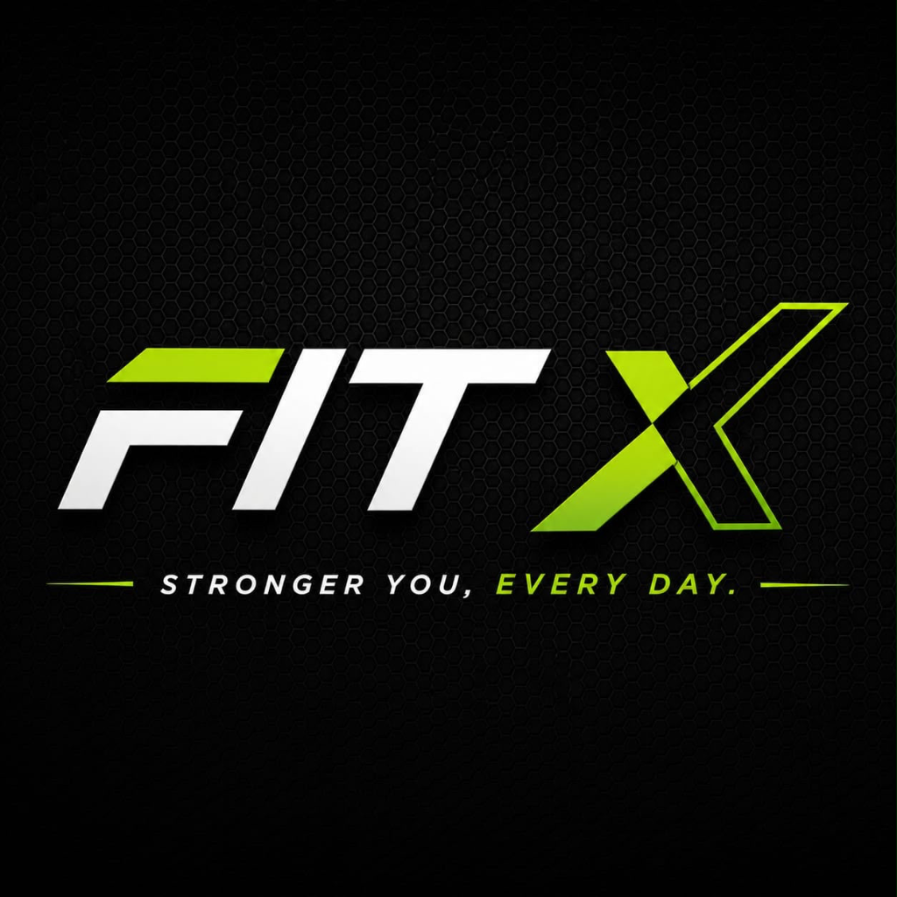

<div align="center">



# FitX

### Stronger You, Every Day · Your AI-Powered Gym & Fitness Companion

[](https://flutter.dev)
[](https://dart.dev)
[](https://riverpod.dev)
[](https://m3.material.io)
[](LICENSE)

**FitX** is a comprehensive, offline-first gym & fitness powerhouse built with Flutter.  
Log workouts, track macros & hydration, compete on community leaderboards, generate smart routines, and receive automated post-workout reviews from an AI coach.

[Getting Started](#-getting-started) · [Features](#-features) · [Navigation](#-navigation-tabs) · [Architecture](#-architecture) · [Roadmap](#-roadmap)

</div>

---

## 📱 Navigation Tabs

FitX features a persistent 5-section bottom navigation bar that preserves state seamlessly across your fitness journey:

| Tab | Focus Area | Highlights |
|---|---|---|
| **🏠 Home** | Dashboard & Metrics | Streaks, calories burned, quick-start workouts & feature shortcuts |
| **🏆 Leaderboard** | Community & Rankings | 🥇 Top-3 podium, weekly/monthly/all-time ranks & XP leaderboards |
| **🏋️ Workout** | Routines & Templates | Push/Pull/Legs/Full-Body routines, custom template creator & logger |
| **🥗 Nutrition** | Diet & Hydration | Macro tracker, animated Water Intake Tracker & AI Meal Suggestions |
| **🤖 AI Coach** | Smart Assistant | Conversational fitness coach for workout, diet & recovery guidance |

---

## ✨ Features

<table>
<tr>
<td width="50%">

### 🏋️ Workout Logging & Templates
- Build workouts from a library of **30+ exercises**
- Pre-built **Workout Templates** (Push, Pull, Legs, Upper, Full Body)
- Save and launch custom workout templates with one tap
- Live session timer with rest-timer alerts & PR tracking
- Full workout history with detailed exercise breakdown

</td>
<td width="50%">

### 🧠 AI Workout Review & Substitution
- **Post-Workout Review** — Automated AI scoring out of 10, volume overload check, muscle balance & recovery estimates
- **Exercise Substitution AI** — Smart biomechanical alternatives (Dumbbells, Cables, Machines, Bodyweight)
- **AI Workout Generator** — Instant routine creation tailored to equipment, duration & fitness goals

</td>
</tr>
<tr>
<td>

### 💧 Water & Nutrition Tracker
- **Water Intake Tracker** — Quick-add logging (`+250ml`, `+500ml`, `Custom`), animated progress & custom goals
- **AI Meal Suggestions** — Instant recipes filling remaining daily calorie & protein targets
- Macro dashboard (calories, protein, carbs, fat) with Indian food database

</td>
<td>

### 🏆 Gamification & Leaderboard
- **Community Leaderboard** — 🥇 Gold, 🥈 Silver, 🥉 Bronze podium across XP, volume & streaks
- **Weekly Challenges** — Consistency Crusher, Hydro Champion, Tonnage Titan with claimable XP
- **Achievement Badges** — Visual milestones for workouts, tonnage & streaks

</td>
</tr>
<tr>
<td>

### 📊 Progress & Summary Reports
- **Weekly & Monthly Summary Reports** — Visual consistency scores, muscle volume breakdown & PDF report sharing
- **fl_chart** interactive weight & volume graphs
- Body metrics tracker (weight, body fat %, measurements)
- Exercise-by-exercise Personal Records (1RM) tracker

</td>
<td>

### ⏰ Smart Notifications & Settings
- **Daily Workout Reminders** — Native time-picker scheduling
- **Inactivity Smart Nudge** — Motivational reminders after 3 days of inactivity
- Light & dark Material 3 theme switcher
- CSV data export & PDF report sharing via `share_plus`

</td>
</tr>
</table>

---

## 🚀 Getting Started

### Prerequisites

| Tool | Version |
|------|---------|
| Flutter SDK | `≥ 3.24` |
| Dart SDK | `≥ 3.4` |

### Run

```bash
# Clone the repo
git clone https://github.com/cbashray/FitX.git
cd FitX

# Install dependencies
flutter pub get

# Launch on connected device, emulator, or web
flutter run
```

> **Platforms:** Android · Web  
> **No backend or API keys required** — all features are operational offline out of the box with seeded storage.

### Demo Account

Tap **"Try Demo Account"** on the sign-in screen to explore with pre-populated workout data and personal records.

---

## 🏗 Architecture

FitX follows a **feature-first clean architecture** with Riverpod for reactive state management and GoRouter for persistent tab routing:

```
lib/
├── main.dart                          # Entrypoint → ProviderScope → MaterialApp.router
├── core/
│   ├── constants/                     # Global constants & feature configs
│   ├── providers/                     # Global repository & service providers
│   ├── routers/                       # go_router StatefulShellRoute config
│   ├── services/                      # NotificationService (local alarms & nudges)
│   ├── theme/                         # Light & dark Material 3 themes
│   └── utils/                         # Formatter & calculation extensions
└── features/
    ├── auth/                          # Local auth (SharedPreferences)
    ├── home/                          # Home dashboard & quick actions
    ├── workouts/                      # Logging, templates, PRs, review & substitution
    ├── exercise_library/              # Exercise catalog, cues & muscle tags
    ├── progress/                      # Charts (fl_chart), body metrics & summary reports
    ├── nutrition/                     # Food log, water intake & AI meal suggestions
    ├── shared/                        # Shared UI, badges, challenges & leaderboards
    └── ai/
        ├── adaptive_workout/          # Goal-based AI routine generator
        └── fitness_coach/             # Conversational AI assistant
```

Each feature is cleanly divided into three layers:
- **`domain/`**: Pure Dart models, entities & repository interfaces.
- **`data/`**: Repository implementations (local storage, SharedPreferences, cache).
- **`presentation/`**: Riverpod providers, UI widgets, and reactive screens.

### Tech Stack

| Layer | Technology |
|-------|-----------|
| **Framework** | Flutter 3.24+ (Material 3 with custom dark theme) |
| **State Management** | Flutter Riverpod 2.6 (`AsyncNotifier`, `NotifierProvider`) |
| **Navigation** | `go_router` (`StatefulShellRoute.indexedStack`) |
| **Persistence** | `shared_preferences` (JSON persistence) |
| **Visual Charts** | `fl_chart` for trend and volume graphs |
| **Reports & Export** | `pdf` + `share_plus` + `path_provider` |
| **Notifications** | `flutter_local_notifications` (reminders & nudges) |
| **Identifiers** | `uuid` for unique entity IDs |
| **CI** | GitHub Actions (`dart.yml` workflow) |

---

## 🗺 Roadmap

### ✅ Completed
- [x] **5-Tab Navigation Bar** (Home, Leaderboard, Workout, Nutrition, AI Coach)
- [x] **Workout Logging & PR Tracker** (Estimated 1RM, rest timer, volume calculation)
- [x] **Workout Templates** (Push, Pull, Legs, Upper, Full Body & custom creator)
- [x] **Exercise Substitution AI** (Biomechanical alternative recommendations)
- [x] **AI Workout Review** (Automated post-workout scoring, volume & recovery analysis)
- [x] **Water Intake Tracker** (Animated progress, quick-add cups & custom daily goals)
- [x] **AI Meal Suggestions** (Smart recipes filling remaining calorie & protein targets)
- [x] **Weekly Challenges & Leaderboards** (Community podium 🥇🥈🥉 and XP quests)
- [x] **Workout Reminders & Inactivity Nudges** (Configurable local notifications)
- [x] **Weekly & Monthly Summary Reports** (Visual KPI metrics & PDF report export)
- [x] **AI Fitness Coach** (Conversational assistant with quick-prompts)
- [x] **Progress & Body Metrics** (`fl_chart` weight/volume tracking)
- [x] **Light & Dark Themes** (Tailored dark mode palette)

### 🚀 Upcoming Features
- [ ] **Camera Form Correction** — Real-time computer vision pose & form analysis
- [ ] **AI Food Camera Recognition** — Snap a photo of your meal to estimate macros
- [ ] **Cloud Sync** — Multi-device synchronization via Firebase / Supabase
- [ ] **Wearables Integration** — Apple Health & Google Health Connect sync

---

## 🤝 Contributing

Contributions are welcome! Please follow clean architecture guidelines:

1. **Fork** the repo
2. **Create** a feature branch (`git checkout -b feature/amazing-feature`)
3. **Commit** your changes (`git commit -m 'feat: add amazing feature'`)
4. **Push** to the branch (`git push origin feature/amazing-feature`)
5. **Open** a Pull Request

---

## 📄 License

This project is licensed under the MIT License — see the [LICENSE](LICENSE) file for details.

<div align="center">

**Built with 💚 and Flutter**

Made by [@cbashray](https://github.com/cbashray)

</div>
