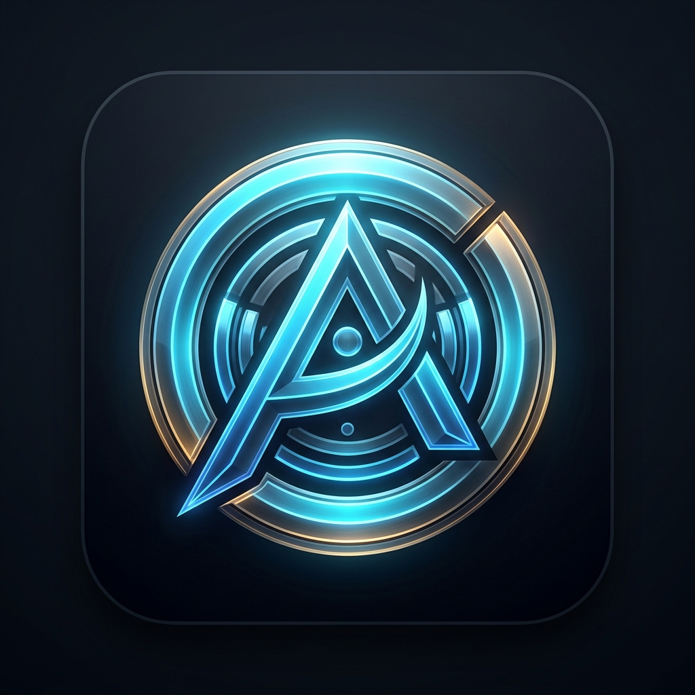

<div align="center">



# ArcFit

### Precision Lifting & AI-Powered Fitness Platform

[](https://flutter.dev)
[](https://dart.dev)
[](https://riverpod.dev)
[](https://m3.material.io)
[](LICENSE)

**ArcFit** is an offline-first, data-dense gym and athletic performance platform built with Flutter.  
Designed for lifters and athletes who want precision tracking: log workouts with live timers and auto-calculating 1RMs, analyze volume trends, track macros and hydration, compete on community leaderboards, generate adaptive workout routines, and receive automated post-workout reviews from an AI coach.

[Key Features](#-features) · [Navigation](#-navigation-tabs) · [Exercise Library](#-exercise-library) · [Getting Started](#-getting-started) · [Architecture](#-architecture) · [Roadmap](#-roadmap)

</div>

---

## 📱 Navigation Tabs

ArcFit features a persistent bottom navigation shell powered by `StatefulShellRoute` that preserves state seamlessly across your training sessions:

| Tab | Focus Area | Highlights |
|---|---|---|
| **🏠 Dashboard** | Command Center | Active streaks, weekly volume, PR alerts, quick-start workouts & feature shortcuts |
| **🏋️ Workouts** | Routines & Logger | Push/Pull/Legs/Full-Body routines, custom template creator, live set logger & rest timer |
| **🥗 Nutrition** | Diet & Hydration | Macro tracker (calories, protein, carbs, fat), animated Water Tracker & AI meal ideas |
| **📊 Progress** | Analytics & Records | Interactive `fl_chart` volume trends, body metrics, PR vault & PDF summary reports |
| **🤖 AI Coach** | Smart Guidance | Conversational coach for workout adjustments, biomechanics & recovery guidance |

---

## ✨ Features

<table>
<tr>
<td width="50%">

### 🏋️ Workout Logging & Precision Sets
- **Live Active Workout Logger** with real-time session stopwatch and rest timer
- Auto-calculated **Estimated 1RM** using Epley formula with real-time PR detection
- Pre-built **Workout Templates** (Push, Pull, Legs, Upper, Lower, Full Body)
- Create, customize, and launch custom workout templates with one tap
- Complete workout history with per-set weight, reps, and RPE tracking

</td>
<td width="50%">

### 🧠 AI Workout Review & Substitution
- **Post-Workout Review** — Automated AI scoring out of 10, volume overload check, muscle balance, and recovery estimates
- **Exercise Substitution AI** — Biomechanical alternatives tailored to available equipment (Barbell, Dumbbell, Cable, Machine, Bodyweight)
- **Adaptive Routine Generator** — Smart routines tailored to target split, fitness level, and equipment

</td>
</tr>
<tr>
<td>

### 💧 Water & Nutrition Tracker
- **Water Intake Tracker** — Quick-add logging (`+250ml`, `+500ml`, custom), visual progress rings, and daily target tracking
- **Macro Dashboard** — Daily calorie and macronutrient breakdown (protein, carbs, fats)
- **AI Meal Suggestions** — Instant high-protein recipes calculated to meet remaining daily macros

</td>
<td>

### 🏆 Gamification & Leaderboard
- **Community Leaderboard** — 🥇 Gold, 🥈 Silver, 🥉 Bronze podium ranking by XP, tonnage, and consistency streaks
- **Weekly Quests** — Consistency Crusher, Hydro Champion, Tonnage Titan with claimable XP rewards
- **Achievement Badges** — Visual milestones for workouts completed, total tonnage lifted, and streaks

</td>
</tr>
<tr>
<td>

### 📊 Progress Analytics & PDF Reports
- **Interactive Volume Graphs** powered by `fl_chart` with day/week intervals
- **Summary Reports** — Weekly and monthly performance summaries with PDF export and system share sheet
- **Body Metrics Tracker** — Log weight, body fat %, and circumferences over time
- **Personal Record Vault** — Track all-time bests across every major compound lift

</td>
<td>

### ⚙️ Settings & System Customization
- **Theme Engine** — High-contrast Light Mode and GitHub/OLED-inspired Dark Mode (`#0D1117`)
- **Daily Workout Reminders** — Native scheduled local notifications
- **Inactivity Nudges** — Smart motivational nudges when training lapses
- **Offline Data Portability** — Complete JSON/CSV data export and privacy-first local storage

</td>
</tr>
</table>

---

## 📚 Exercise Library

ArcFit includes a curated library of **120 exercises** across all primary muscle groups (20 targeted movements per category), each with execution cues, muscle activation tags, and equipment requirements:

- **Chest (20)**: Flat/Incline/Decline Barbell Bench Press, Dumbbell Presses, Machine & Smith Presses, Cable Crossovers, Flyes, Dips, Push-Ups & Landmine Press.
- **Lats & Back (20)**: Pull-Ups, Chin-Ups, Lat Pulldowns, Bent-Over Rows, Pendlay Row, Single-Arm Dumbbell Rows, T-Bar Rows, Cable Rows & Pullovers.
- **Biceps (20)**: Barbell & EZ-Bar Curls, Dumbbell Curls, Incline Curls, Preacher Curls, Hammer Curls, Cable Curls, Bayesian Curls & 21s.
- **Triceps (20)**: Close-Grip Bench Press, Skull Crushers, JM Press, Overhead Extensions, Cable Pushdowns (Rope, Straight-Bar, V-Bar), Dips & Diamond Push-Ups.
- **Shoulders (20)**: Overhead Press, Dumbbell Shoulder Press, Arnold Press, Lateral Raises (Dumbbell, Cable, Machine), Face Pulls, Rear Delt Flyes & Upright Rows.
- **Legs (20)**: Barbell Back Squat, Front Squat, Goblet Squat, Hack Squat, Leg Press, Bulgarian Split Squat, Romanian & Conventional Deadlifts, Leg Curls & Calf Raises.

---

## 🚀 Getting Started

### Prerequisites

| Tool | Minimum Version |
|------|-----------------|
| Flutter SDK | `≥ 3.24.0` |
| Dart SDK | `≥ 3.4.0` |

### Installation

```bash
# Clone the repository
git clone https://github.com/cbashray/ArcFit.git
cd ArcFit

# Install dependencies
flutter pub get

# Launch on connected device, emulator, or web
flutter run
```

> **Offline-Ready:** ArcFit runs 100% offline out of the box with seeded demo data and persistent local storage via `shared_preferences`.

### Demo Account

Tap **"Try Demo Account"** on the sign-in screen to instantly explore the app with pre-configured workout history, personal records, and active habits under `demo@arcfit.app`.

---

## 🏗 Architecture

ArcFit follows a **Feature-First Clean Architecture** with Flutter Riverpod for reactive state management and GoRouter for declarative tab navigation:

```
lib/
├── main.dart                          # Application entrypoint & ProviderScope initialization
├── core/
│   ├── config/                        # App & backend configurations
│   ├── constants/                     # Design tokens, keys & defaults
│   ├── providers/                     # Global repository & service providers
│   ├── routers/                       # Declarative GoRouter & StatefulShellRoute
│   ├── services/                      # NotificationService (local alarms & nudges)
│   ├── theme/                         # Light & Dark ArcFit design system
│   └── utils/                         # Date, string, and math calculation utilities
└── features/
    ├── auth/                          # Local auth repository & profile management
    ├── dashboard/                     # Command center dashboard & quick metric cards
    ├── workouts/                      # Active logger, template engine, PR detector & review
    ├── exercise_library/              # 120-exercise catalog, seed data & search
    ├── nutrition/                     # Food logging, water tracking & AI meal generator
    ├── progress/                      # fl_chart analytics, body metrics & PDF exporter
    ├── shared/                        # Data-dense design components, gamification & leaderboards
    ├── settings/                      # Preferences, theme toggling & data export
    └── ai/
        ├── adaptive_workout/          # Adaptive workout generator
        └── fitness_coach/             # Conversational AI coach
```

Each feature maintains strict separation of concerns across three layers:
- **`domain/`**: Pure Dart entities, value objects, and repository contracts.
- **`data/`**: Concrete repository implementations (JSON local persistence, seed loaders).
- **`presentation/`**: Riverpod `Notifier` / `AsyncNotifier` providers and reactive UI screens.

---

## 🛠 Tech Stack

| Layer | Technology |
|---|---|
| **Framework** | Flutter 3.24+ (Dart 3.4+) |
| **State Management** | Flutter Riverpod 2.6 (`AsyncNotifier`, `NotifierProvider`) |
| **Navigation** | `go_router` (`StatefulShellRoute.indexedStack`) |
| **Visual Charts** | `fl_chart` for volume, tonnage, and metric tracking |
| **Local Persistence** | `shared_preferences` (offline-first JSON store) |
| **Reports & Export** | `pdf` + `share_plus` + `path_provider` |
| **Notifications** | `flutter_local_notifications` (scheduled reminders & timers) |
| **AI Integration** | `google_generative_ai` (Gemini API for coaching & reviews) |
| **Testing** | `flutter_test` unit and widget test suite |

---

## 🗺 Roadmap

- [x] **Zero-dependency offline operation** with seeded initial data
- [x] **120-movement exercise library** across 6 muscle categories
- [x] **Active workout logger** with auto-rest timer, 1RM tracking, and PR celebration
- [x] **Interactive Volume & Progress Charts** with `fl_chart`
- [x] **Gamification System** with XP, weekly challenges, and achievement badges
- [x] **AI Coach & Post-Workout Analysis**
- [x] **PDF Summary Report Generation** and CSV data export
- [ ] **Multi-device Cloud Sync** (Supabase / Firebase backend)
- [ ] **Wearable Health Sync** (Apple HealthKit & Google Health Connect)
- [ ] **Camera Pose Estimation** for real-time lifting form feedback

---

## 📄 License

This project is licensed under the MIT License — see the [LICENSE](LICENSE) file for details.

<div align="center">

Made with ⚡ by [@cbashray](https://github.com/cbashray)

</div>
